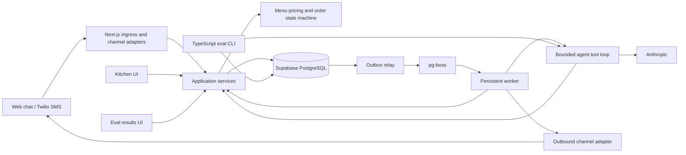

# AGENTS.md — DeliFlow

## Mission and working process

Build a bilingual English/Spanish bodega and deli ordering application that demonstrates reliable AI integration, deterministic business rules, and measurable results. Optimize for a small, understandable system that can be finished, deployed, and explained.

For each task:

1. Inspect the existing code, package scripts, tests, schema, and relevant ADRs before editing. Follow established conventions; the layout below is a bootstrap suggestion, not a reason to reorganize working code.
2. Identify the affected business invariant and observable acceptance criterion. Resolve routine implementation choices yourself; surface missing business policy when it changes customer commitments.
3. Implement the smallest complete vertical slice. Keep domain rules independent of frameworks, providers, and prompts.
4. Run the relevant checks. For reliability fixes, include a regression that reproduces the failure; for prompt/model/tool changes, run the applicable eval slices.
5. Report changed behavior, verification results, and remaining limitations. Distinguish implemented behavior from proposed work and measured results from targets.

This file specifies the intended system, not an assertion that the repository already implements it. Create referenced documentation and scripts as their milestones are implemented. Read `docs/architecture.md` before changing module boundaries, the applicable `docs/adr/` records before changing a recorded decision, and `docs/runbook.md` before changing deployment or recovery behavior, when those files exist.

## Stack and scope

| Concern | Required choice |
| --- | --- |
| Application | TypeScript with strict checking; Next.js App Router for web chat, kitchen UI, eval UI, and API routes |
| Web deployment | Vercel; use a compatible Node.js runtime for Prisma and provider SDK routes |
| Data | Supabase PostgreSQL; Prisma schema, migrations, and data access |
| Messaging | Twilio SMS with signature validation; web chat through the same application services |
| Agent | Anthropic native tool calling through a small handwritten loop; Zod schemas |
| Business rules | Pure TypeScript order state machine and server-side pricing |
| Background work | pg-boss on PostgreSQL; a persistent worker deployed on Railway, Fly.io, or equivalent |
| Rate limiting | PostgreSQL initially; add Upstash Redis only for a measured need documented in an ADR |
| Evals | TypeScript CLI; gold conversations, synthetic customer simulator, deterministic graders; Postgres results and Next.js results UI |
| Observability | Langfuse traces, Sentry errors, pino structured logs |
| Testing | Vitest, Playwright, k6 |
| Development and CI | Docker Compose, ngrok or Cloudflare Tunnel, GitHub Actions, Mermaid diagrams, short ADRs |

Use one repository and a modular monolith, with separate web and worker processes sharing application/domain code. Keep TypeScript for the eval harness too. Use the existing package manager; for a new repository, select one, commit its lockfile, and expose commands through package scripts.

Do not introduce LangChain, Kubernetes, microservices, vector databases, or fine-tuning. A deli menu belongs in a bounded structured context. WhatsApp is a later channel adapter, not an MVP dependency. Default MVP scope is one deli, pickup orders, and payment at the counter; online payments, delivery dispatch, and inventory reservation require an explicit scope change. Label the public demo clearly and isolate its orders and notifications from real operations.

## Architecture and module boundaries



The diagram is the target architecture; document the implemented version in the README and `docs/architecture.md` as it develops.

- **Domain:** canonical menu IDs, modifier rules, money calculations, order commands, transitions, typed errors. Pure functions; inject clocks and identifiers where needed.
- **Application:** authorization, transaction boundaries, idempotency, orchestration, and repositories. Both tools and kitchen actions call this layer.
- **Agent:** prompt construction, native tool protocol, bounded execution, and language selection. It has no direct database mutation or outbound messaging access.
- **Channels:** verify/normalize inbound events and format/send outbound messages. Translate to a shared envelope with channel, trusted sender identity, provider event ID, conversation ID, and receipt time.
- **Infrastructure:** Prisma repositories, pg-boss, provider SDK clients, telemetry, secrets, and rate limiter implementations.
- **UI/routes:** presentation and boundary validation. Enforce authorization on the server; never duplicate pricing or transition rules in React.
- **Evals:** invoke the same agent and application paths through replaceable provider/channel interfaces. Use isolated data and fake outbound adapters.

Suggested structure:

```text
src/
  app/                   # chat, kitchen, eval pages, API routes
  modules/
    menu/                # domain rules and menu application services
    orders/              # lifecycle, pricing, commands, persistence ports
    conversations/       # inbox, turn ordering, confirmation context
    agent/               # prompts, tool registry, native tool loop
    channels/            # shared contract, web, Twilio SMS
    evals/               # runner, graders, result queries
  infrastructure/        # db, queue, providers, rate limits, telemetry
  workers/               # entry point, outbox relay, job handlers
  shared/                # small genuinely shared types/utilities
prisma/                  # schema, migrations, synthetic seed
evals/                   # gold cases, simulator personas, gate config
tests/                   # integration, e2e, load, fixtures
docs/                    # architecture.md, runbook.md, adr/
.github/workflows/
compose.yaml
.env.example
```

Prefer explicit types, discriminated unions, and typed domain errors. Parse untrusted boundaries with Zod and derive types from schemas where practical. Keep provider-specific types inside adapters. Use parameterized queries for any SQL beyond Prisma; migrations may include PostgreSQL constraints Prisma cannot express.

## Data invariants

Persist menus, menu versions, items, modifier groups/options, conversations, messages, orders, order lines/modifiers, order events, inbox processing records, outbox records/delivery attempts, and eval runs/results. Tables may be combined where their semantics remain explicit.

- Use stable internal IDs and foreign keys. Scope every lookup to the authenticated session/customer or staff role and store. A model-provided order ID never grants access.
- Represent USD amounts as integer cents; require bounded positive integer quantities. Compute base prices, modifier adjustments, tax, and totals on the server using a documented rounding policy. Configure tax rules; do not invent a rate.
- Validate item availability, allowed modifier membership, required choices, selection limits, and incompatible combinations against the authoritative menu.
- Store line descriptions, canonical IDs, menu version, unit prices, modifier prices, tax policy/version, and totals as order snapshots. Historical orders must not change when the menu changes.
- Give mutable orders a version. Commit an accepted command, version increment, append-only event, and any outbound intent atomically. Enforce unique `(order_id, version)` for state-changing events.
- Events record actor, command ID, prior/new state, timestamp, and a minimal structured change. Keep routine business updates append-only; privacy deletion/redaction must use a separate documented privileged procedure.
- Enforce inbound uniqueness on `(provider, provider_account, provider_message_id)` and web-message uniqueness on a server-scoped client idempotency key. Enforce order creation/confirmation uniqueness with a stable application command key; retries return the existing result.
- Bind an idempotency key to its operation, owner, and payload hash. Reject reuse with different input. Do not use a freshly generated LLM tool-call ID as the sole business idempotency key.
- Enforce the MVP's one-active-draft-per-conversation rule with a database constraint or transactional equivalent. Terminal orders remain history; starting a new order requires a new draft and confirmation.
- Use UTC timestamps; convert for display and store business hours with an explicit timezone. Keep customer contact data separate from long-lived audit/eval data.

## Order lifecycle and customer consent

Keep order state separate from message processing, delivery status, and conversation assistance status.

| State | Allowed next state | Authorized trigger |
| --- | --- | --- |
| `DRAFT` | `AWAITING_CONFIRMATION`, `CANCELLED`, `EXPIRED` | Customer builds a valid basket; customer cancels; draft timeout |
| `AWAITING_CONFIRMATION` | `DRAFT`, `CONFIRMED`, `CANCELLED`, `EXPIRED` | Edit/requote; explicit customer confirmation; cancellation; quote timeout |
| `CONFIRMED` | `ACCEPTED`, `CANCELLED`, `REJECTED` | Staff accepts; customer cancels before acceptance or staff cancels; staff rejects |
| `ACCEPTED` | `PREPARING`, `CANCELLED` | Staff only; cancellation requires staff approval |
| `PREPARING` | `READY`, `CANCELLED` | Staff only; cancellation requires staff approval |
| `READY` | `COMPLETED`, `CANCELLED` | Staff records pickup or approves an exceptional cancellation |
| `COMPLETED`, `CANCELLED`, `REJECTED`, `EXPIRED` | None | Terminal; create a new order for a new purchase |

Implement one transition function and explicit actor/guard checks. Reject all other transitions. `CONFIRMED` means the customer submitted the order; only `ACCEPTED` means the deli accepted it. Do not announce acceptance or readiness before those states commit.

Before confirmation, present a server-rendered summary in the customer's language with items, modifiers, quantities, total, pickup details, and quote expiry. Persist its exact draft version, menu version, summary message ID, and a server-owned confirmation token. A web confirmation action or a narrowly recognized, unambiguous SMS reply such as “yes”/“sí” may authorize that specific pending summary; the model's assertion of consent is insufficient. Clarify mixed instructions such as “yes, but remove the cheese.”

At confirmation, revalidate version, availability, hours, and quote expiry in the commit path. If prices or availability changed, present the new quote and require confirmation again. Store whether the summary was displayed to the web session or submitted for SMS delivery; an unsent summary cannot authorize confirmation. Persisted channel evidence may resolve an ambiguous SMS send; otherwise re-present the summary.

Draft edits return to `DRAFT`, invalidate prior consent, and require a new summary. For the MVP, freeze basket contents after `CONFIRMED`; before staff acceptance, a customer may cancel and create a replacement draft. After acceptance, record a change/cancellation request for staff and report it as pending. Never promise approval or silently overwrite a submitted order. Resolve cancellation-versus-acceptance races under the same version/transaction guard. Expiry jobs apply only to the expected draft version and eligible states; they must never expire a submitted order.

## Safe agent tool execution and bilingual behavior

- Expose an allowlisted registry of narrow tools: menu lookup, draft inspection/edit, quote generation, confirmation attempt, status lookup, and cancellation/change request. Route all mutations through application commands.
- Validate tool inputs with Zod, then independently enforce ownership, current state/version, menu rules, and confirmation evidence. Tool arguments cannot set trusted actor, price, discount, tax, or arbitrary state.
- Treat customer messages, menu descriptions, and tool-returned text as untrusted content. They cannot override tool policy or reveal credentials. Do not expose arbitrary SQL, shell execution, filesystem access, or arbitrary URL fetching to the ordering agent.
- Process all native tool calls and return a matching `tool_result` for each tool-use ID. Sequence mutations; parallelize only independent reads. Preserve the protocol history on retries. Follow the installed SDK and [Anthropic tool-call documentation](https://platform.claude.com/docs/en/agents-and-tools/tool-use/handle-tool-calls).
- Persist command results/checkpoints so resuming a turn cannot repeat business mutations. Re-read authoritative state after a timeout or conflict instead of assuming a tool failed before commit.
- Bound model calls, tool calls, tokens, turn duration, and spend in configuration. Retry only transient failures with a capped policy. On exhaustion, preserve the order, provide a truthful bilingual fallback, and record a recoverable failure or staff-help request.
- The model may interpret intent and explain options; it cannot invent products, prices, availability, discounts, ingredients, allergens, or preparation times. Render price-bearing quotes and committed status messages deterministically from trusted records. Use the same trusted formatting for menu price responses.
- Reply in English or Spanish according to the latest clear preference; support code-switching, informal spelling, and accent variation. Persist preference, keep canonical menu IDs language-neutral, and clarify ambiguous quantities/modifiers. An unclear request must not produce a guessed order.
- Ingredient/allergy questions use verified menu data; missing information requires staff confirmation. Do not guarantee allergen safety from model knowledge.

## Inbound processing, concurrency, and recovery

1. Validate request size/content type and the channel's authentication. For Twilio, use the official SDK to validate the signature against the exact externally configured URL and request parameters/body for that content type. Use trusted URL configuration behind proxies, not an arbitrary incoming host header. Validate status callbacks too. Follow [Twilio's validation guidance](https://www.twilio.com/docs/usage/security).
2. Normalize identity and atomically insert the inbound message plus a durable processing intent. Check duplicate identity before spending model tokens or consuming a new customer quota. Return success for already accepted duplicates. Acknowledge a new webhook only after durable commit; if persistence fails, return a retryable failure. Do not wait for the LLM in the webhook.
3. Publish processing intents through the outbox relay to pg-boss. Give each job a stable logical key and make handlers idempotent. Assume retries and crash recovery can repeat execution, regardless of queue delivery terminology.
4. Serialize turns per conversation with a database-backed lease and fencing token, or an equivalent documented mechanism. Assign a durable local receipt sequence; do not infer a guaranteed SMS send order from provider IDs. Process earlier pending turns first and clarify ambiguous late arrivals.
5. Call external providers outside database transactions. On commit, check conversation fencing token, consumed message sequence, and order version; discard stale work and reload on conflict. A stale worker cannot mutate state after losing its lease. Use short transactions and bounded conflict retries. See [Prisma transaction guidance](https://docs.prisma.io/docs/orm/v7/prisma-client/queries/transactions), using the documentation version matching the installed client.
6. Atomically persist command result, processing checkpoint, order event, and any outbound intent. Recover expired leases and retry due jobs. Surface exhausted jobs for inspection and replay with the original logical keys.

Queue concurrency limits alone are not a per-conversation lock. An in-memory mutex or rate limiter is insufficient across web/worker replicas. Bound pending turns per conversation and worker concurrency to prevent one sender exhausting the system. For valid but over-quota messages, durably record the decision and acknowledge it without triggering expensive work; reserve retryable errors for recoverable ingestion failures.

## Transactional outbox and notifications

Use an application outbox as the default bridge between Prisma commits, pg-boss jobs, and notifications. Do not assume a Prisma transaction and a separately issued queue call are atomic.

- Insert a unique intent with the business transaction, keyed by logical event, recipient, channel, and notification type. A relay claims due records with a lease, enqueues with a stable key, and retries after crashes. Duplicate relay execution must be harmless.
- Keep delivery attempts and provider message IDs separate from business state. Distinguish pending, sending, provider-accepted, delivered, failed, and uncertain outcomes. A provider accepting an SMS is not proof it was delivered.
- Preserve outbound order per conversation and recheck an intent's expected version/relevance before sending. Suppress obsolete unsent quotes or statuses; record why they were suppressed.
- A network timeout can occur after a provider accepted a send. Do not claim exactly-once SMS delivery or blindly resend an uncertain attempt. Use verified provider idempotency if available for that endpoint; otherwise reconcile using persisted attempt/callback evidence and expose unresolved attempts for operator review. Document the remaining duplicate-versus-missing-message tradeoff.
- Verify, deduplicate, and tolerate delayed or out-of-order delivery callbacks. Do not regress a terminal delivery result based only on arrival order.
- Notification failures must not roll back committed orders. Kitchen UI reads durable order state, with polling sufficient for the MVP. Recovery must work even when SMS is unavailable.

Use [pg-boss documentation](https://github.com/timgit/pg-boss) for the installed version's connection, retry, and job options; verify them in integration tests rather than relying on a queue guarantee to protect external side effects.

## Privacy, security, and observability

- Require authenticated staff roles for kitchen actions, menu administration, eval details, and recovery controls. Use Supabase Auth for staff unless the repository already has an appropriate solution. Public chat gets an opaque, server-validated session; guessing an order/conversation ID must not reveal data.
- Keep Prisma/database credentials and provider secrets server-side. Treat Prisma access as privileged: Supabase RLS is not a substitute for application authorization when the connection bypasses it. Protect any directly exposed Supabase tables separately.
- Validate origin/CSRF protections for cookie-authenticated mutations, sanitize displayed text, limit input sizes, and reject unsupported attachments. Verify sender/account routing against configured Twilio identities.
- Rate-limit by trusted sender/session plus appropriate IP/global budgets; configure separate staff, demo, and provider budgets. Enforce database-backed atomic limits before LLM calls. Protect against unauthenticated demo spend.
- Store only needed contact/order data. Redact phone numbers, customer names, free-text messages, authorization headers, and secrets from pino, Sentry, and Langfuse by default. Use pseudonymous correlation IDs; limit/redact context sent to Anthropic. No production transcripts in fixtures or simulator prompts without an approved sanitization process.
- Document retention periods, deletion/redaction jobs, authorized access, backup retention, and provider telemetry settings before collecting real customer data. Keep PII out of append-only order events so audit retention does not require retaining message bodies or phone numbers.
- Use synthetic identities in local development, CI, evals, and public demo mode. Disable real outbound SMS in these environments except explicitly configured test recipients. Handle opt-out/help and blocked-delivery signals through channel policy; the model cannot override them.
- Correlate message, conversation, command, order, job, outbox attempt, and trace IDs. Track webhook acknowledgement latency, oldest queue age, retries, stale conflicts, duplicate suppression, failed/uncertain notifications, LLM/tool latency, token cost, and eval scores by language.
- Instrument Langfuse for redacted per-turn/model/tool traces, Sentry for actionable errors, and pino for structured operational logs. Telemetry failure must not fail an otherwise valid order. Add actionable alerts and recovery steps, not raw transcript dumps.

## Evals and acceptance gates

Create a TypeScript CLI that can run a named suite, select a model/prompt version, compare a baseline, emit machine-readable results, and exit nonzero on a gate failure. Keep model/provider configuration outside grader logic. Store each run's code revision, model ID, prompt/tool/schema versions, dataset version, menu fixture, configuration, timestamps, scores, latency, tokens, and cost in Postgres. Persist case-level assertions and sanitized failure evidence. The UI must show history, failed cases, language/category slices, and comparable model runs.

Gold cases specify initial state/menu, user turns, expected structured basket/state, permitted or forbidden actions, and exact deterministic assertions. Judge business outcomes rather than exact prose. Include English, Spanish, code-switching, misspellings, modifiers, ambiguity, unavailable items, price changes, cancellation, confirmation, injection attempts, duplicate input, and provider failure. Mark expected clarification/refusal as successful outcomes where appropriate.

Use a second LLM as a synthetic customer with bounded personas, hidden goals, and turn budgets. The simulator cannot see grader answers or become its own authoritative judge. Archive generated conversations/configuration for replay; inspect useful failures and promote them into fixed gold cases. A random seed or low temperature does not guarantee provider reproducibility. Keep any qualitative model judging advisory; deterministic state/action assertions control correctness gates. Human-review bilingual quality before release.

Initial release gates below are project targets, not measured claims. Commit them to versioned gate configuration; changing a gate requires an explained review, never an automatic baseline refresh to hide failures.

| Gate | Acceptance criterion |
| --- | --- |
| Gold coverage | At least 60 reviewed cases: 25 English, 25 Spanish, 10 code-switching; categories above represented |
| Critical invariants | 100% pass: authorized access, valid totals/menu, explicit current confirmation, legal transitions, and no duplicate business effects |
| Task success | At least 95% overall and 90% in each language slice, using fixed denominators and expectations |
| Regression | No new critical failure; no more than a 2 percentage-point task-success drop versus the approved baseline on the same suite; compare repeated runs for release decisions |
| Language behavior | At least 95% preference adherence on labeled cases; human review for clarity, with all price/status assertions still deterministic |
| Recovery | Duplicate, concurrency, stale-worker, crash-window, and ambiguous-send tests all pass |
| Performance | Controlled staging target: p95 durable webhook acknowledgement under 1 second at 10 requests/second for 5 minutes, less than 1% unexpected 5xx, and zero lost acknowledged inbox records |

Define and version the language-adherence rubric/detector and review ambiguous cases rather than presenting a heuristic as proof. Report sample sizes and repeated-run variation; small gold suites cannot establish production reliability. For performance, record environment, concurrency, provider mocks, and payload mix. Use k6 to test ingestion and order contention without sending real SMS; separately measure live-model end-to-end latency and cost under a bounded budget. Set explicit release latency/cost budgets after the first measured baseline.

## Tests and CI

- **Vitest unit:** pricing/rounding, modifier validation, every allowed/rejected transition and actor guard, quote invalidation, confirmation parsing, tool validation, bilingual deterministic templates, retry bounds.
- **Vitest integration with PostgreSQL:** unique constraints, atomic rollback, concurrent confirms, cancel/accept races, duplicate webhooks, per-conversation sequencing, lease fencing, outbox retry, and authorization isolation. Do not substitute SQLite for database concurrency tests.
- **Failure injection:** crash after inbox commit/before enqueue; after order commit/before job acknowledgement; after provider acceptance/before delivery persistence; stale worker resumes; callbacks arrive twice or out of order. Assert stored state, event counts, and recovery outcome, not just HTTP codes.
- **Playwright:** English and Spanish chat-to-confirmation flows, edit/reconfirm, staff accept/prepare/ready/complete, cancellation conflict, protected kitchen/eval routes, and reconnect/reload without duplicate submissions. Cover keyboard interaction and accessible error/status feedback.
- **Security cases:** invalid Twilio signatures, proxy URL mismatches, cross-session IDs, privilege escalation through tool arguments, injection prompts, PII leakage, and rate-limit enforcement.

GitHub Actions on every PR: locked dependency install, formatting/lint, TypeScript checks, Prisma validation/generation, migration application to an ephemeral PostgreSQL instance, unit/integration tests, production build, focused Playwright flows, and a fixed fast eval suite. Provide provider-fake/recorded protocol tests for secretless PRs and label them as offline tests, not live model quality evidence.

Run credentialed live gold evals for prompt/model/tool changes in a trusted workflow, and the full live suite on a schedule or explicit label/manual trigger. Never expose secrets to arbitrary fork code or use a privileged workflow to run unreviewed PR code. Require applicable live gates before releasing behavioral changes. Store reports as CI artifacts and sanitized run records. Run k6 for performance-sensitive changes and pre-release staging checks. Missing credentials must produce an explicit skipped/blocked live gate, never a fabricated pass.

## Development and deployment boundaries

- Docker Compose starts PostgreSQL, app, and worker with synthetic seeds and fake provider defaults. Document reproducible setup/reset steps and health checks. Use a tunnel for local Twilio webhooks; configure its exact public URL and retain signature verification.
- Vercel handles short request/response work and durable ingress; persistent pg-boss consumers, outbox dispatch, retries, timeout jobs, and scheduled recovery run in the worker host. Do not depend on request-lifetime background promises for correctness.
- Use appropriate Supabase connections for each workload. Verify pooling/transaction behavior for web queries, migrations, and the installed pg-boss features separately; give the worker a compatible direct or session connection when required. Budget connection counts across deployments.
- Validate environment configuration at startup. Document variable names in `.env.example` with placeholders; keep secrets out of Git and client bundles. Separate local, preview, staging, demo, and production data/provider credentials.
- Apply reviewed migrations once through a controlled release job using Prisma's deployment workflow. Use backward-compatible schema changes so web and worker revisions can overlap. Test migrations from the prior schema and document rollback/forward-fix procedures; never reset production data.
- Worker shutdown stops claiming new work and safely finishes or relinquishes leases. Recovery scans for stranded inbox/outbox work and expired leases. Check database/queue readiness separately from liveness.
- Document deployment, webhook configuration, dead-job replay, uncertain-send review, provider outage response, backup/restore verification, and schema compatibility in `docs/runbook.md`.
- Add short ADRs for module boundaries, conversation serialization, confirmation policy, outbox/notification semantics, and eval gate choices. Each records context, choice, alternatives, and consequences; keep it proportional to the decision.

## Milestones

1. **Deterministic core:** schema/migrations, synthetic bilingual menu, pricing, state machine, and authorization model. Done when unit and PostgreSQL invariant tests pass without an LLM.
2. **Web ordering slice:** bounded Anthropic tool loop, web chat, version-bound confirmation, and protected kitchen UI. Done when English/Spanish end-to-end tests create exactly one correctly priced order and progress it to pickup.
3. **Durable messaging:** signed Twilio ingress, shared channel interface, pg-boss worker, outbox, idempotency, rate limits, and recovery. Done when duplicate/concurrent/crash tests pass and the kitchen can operate during SMS failure.
4. **Measured AI quality:** gold suite, simulator, deterministic graders, Postgres results, eval UI, and CI gates. Done when an intentional regression fails CI and a reproducible baseline meets the release targets.
5. **Deployable demo:** Vercel plus worker deployment, redacted Langfuse/Sentry/pino instrumentation, staging load results, Mermaid docs, ADRs, and runbook. Done when a clean setup and deployed bilingual demo work with isolated data and documented recovery evidence.

Finish each milestone's usable slice before adding optional channels or infrastructure.

## Definition of done

A change is complete when its acceptance criterion is demonstrated; affected invariants and failure paths are tested; relevant CI/eval gates pass; migrations/configuration are reproducible; customer-visible behavior works in English and Spanish; security and redaction checks cover new data paths; and operational/docs changes match the implementation. Report any unrun checks and why they could not run. Never claim a production guarantee, benchmark, or accuracy improvement without recorded evidence.

For the initial release, also require all milestones above, a clean-checkout setup, a deployed demo, a measured baseline with sample sizes and limitations, and a documented drill showing acknowledged messages recover after worker restart without duplicate orders.
